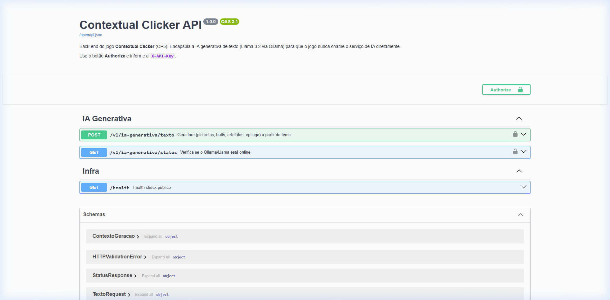
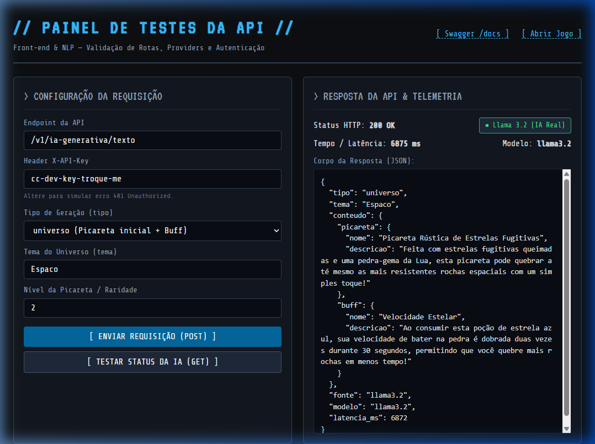
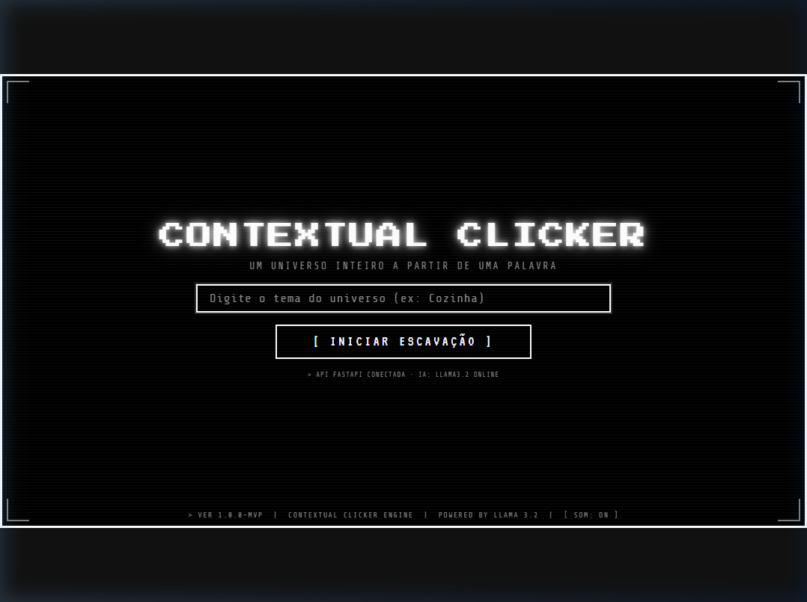
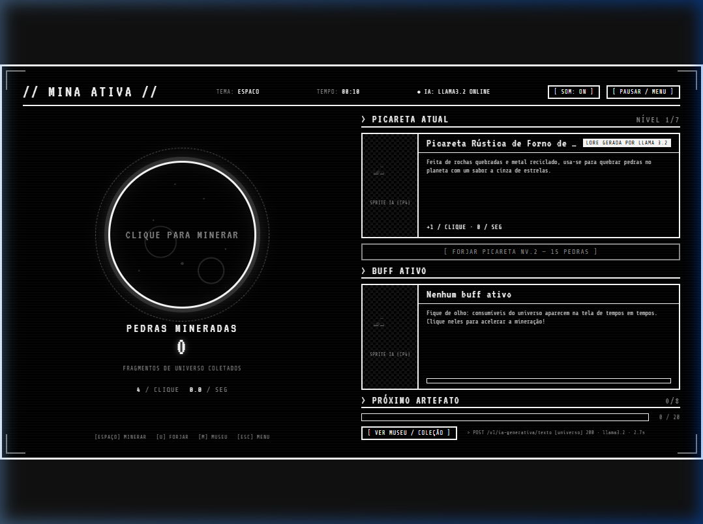
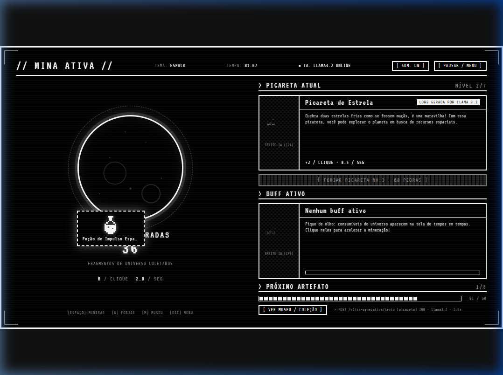
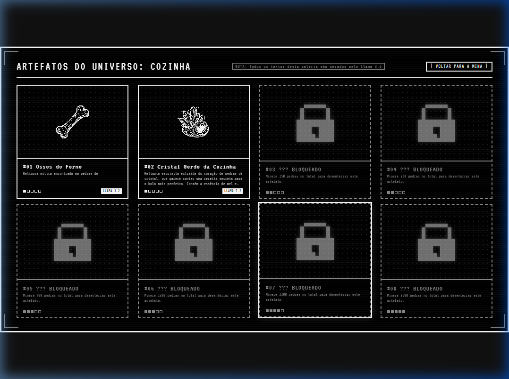

# Contextual Clicker — Checkpoint 5 (Entrega de Front-End)

<div align="center">

### FIAP — Tecnólogo em Inteligência Artificial — 2TIAPY (2º Semestre / 2026)
**Disciplina:** Front-End  
**Projeto Interdisciplinar:** Contextual Clicker (Desacoplamento de API e Consumo Web)

---

### 👥 Integrantes do Grupo

| Nome do Integrante | RM |
| :--- | :---: |
| **Paulo Gabriel Pessoa da Silva** | **566446** |
| **William Stahl Sanches Furquim Garcia** | **562800** |

---

[](https://fastapi.tiangolo.com/)
[](./frontend/index.html)
[](#-testes-automatizados)
[](#)

</div>

---

## 📹 Demonstração em Vídeo

> **Arquivo de Vídeo Incluído no Projeto:** [`PRINTS/demonstracao_execucao.webp`](./PRINTS/demonstracao_execucao.webp)  
> **Link Video de teste do jogo:** *https://youtu.be/-tglE4MjA-E*

---

## 🎯 Objetivo e Desacoplamento da Arquitetura

O **Contextual Clicker** é um jogo *idle/clicker* procedural com estética retrô 1-bit CRT. O objetivo deste checkpoint para a matéria de **Front-End** é:

1. **Desacoplar a IA Generativa do Front-End:** O navegador **nunca** se comunica diretamente com o serviço externo de IA (Ollama / Llama 3.2). Toda a comunicação é intermediada por uma API própria construída em **FastAPI**.
2. **Separação Clara em Dois Projetos:**
   - `backend/`: Servidor FastAPI estruturado no padrão **Router ➔ Provider**, com autenticação via cabeçalho HTTP `X-API-Key`, CORS configurado e documentação Swagger automática.
   - `frontend/`: Aplicação web do jogo (HTML5, CSS3 e JavaScript Vanilla) consumindo a API própria via requisições assíncronas `fetch()`, acompanhada de um painel de testes interativo (`painel.html`).
3. **Mecanismo de Resiliência (Fallback Gracioso):** Caso o professor não possua o Ollama ou o modelo Llama 3.2 instalado em sua máquina, o back-end e o front-end ativam automaticamente um gerador procedural temático sem travar a execução nem interromper a partida.

---

## 🏗️ Diagrama de Comunicação

```
┌────────────────────────────────────────────────────────┐
│                   FRONT-END (Navegador)                │
│   • Jogo:     frontend/index.html                      │
│   • Painel:   frontend/painel.html                     │
│   • Cliente:  frontend/js/api.js                       │
└───────────────────────────┬────────────────────────────┘
                            │
                            │ Requisição HTTP POST /v1/ia-generativa/texto
                            │ Headers: { "Content-Type": "application/json",
                            │            "X-API-Key": "cc-dev-key-troque-me" }
                            │ Body: { "tipo": "universo", "tema": "Espaço" }
                            ▼
┌────────────────────────────────────────────────────────┐
│                   BACK-END (FastAPI)                   │
│                                                        │
│   1. [Security] Validação da API Key (core/security.py)│
│   2. [Router]   Encaminhamento (routers/ia_generativa) │
│   3. [Provider] Lógica isolada (providers/ia_provider) │
└─────────────┬────────────────────────────┬─────────────┘
              │ (Se Ollama Online)         │ (Se Ollama Offline)
              ▼                            ▼
┌──────────────────────────┐  ┌──────────────────────────┐
│   OLLAMA / LLAMA 3.2     │  │   FALLBACK PROCEDURAL    │
│   (Porta 11434 local)    │  │   (Garante execução 100%)│
└──────────────────────────┘  └──────────────────────────┘
```

---

## 📁 Estrutura do Repositório (Dois Projetos Separados)

```
Contextual Clicker/
├── backend/                              # [PROJETO 1] Back-End FastAPI
│   ├── .env.example                      # Modelo de variáveis de ambiente
│   ├── .env                              # Configurações ativas (chave, portas, cors)
│   ├── requirements.txt                  # Dependências Python (FastAPI, uvicorn, etc.)
│   ├── painel_streamlit.py               # Painel opcional em Streamlit
│   ├── app/
│   │   ├── __init__.py
│   │   ├── main.py                       # Ponto de entrada FastAPI, CORS e rotas
│   │   ├── schemas.py                    # Modelos Pydantic (validação de I/O)
│   │   ├── prompts.py                    # Engenharia de prompts para o Llama 3.2
│   │   ├── core/
│   │   │   ├── config.py                 # Leitura das variáveis do .env
│   │   │   └── security.py               # Validação do cabeçalho X-API-Key
│   │   ├── providers/
│   │   │   ├── ia_provider.py            # Provider desacoplado (comunicação com a LLM)
│   │   │   └── fallback_provider.py      # Provider de contingência (resiliência)
│   │   └── routers/
│   │       └── ia_generativa.py          # Router dedicado /v1/ia-generativa
│   └── tests/
│       └── test_api.py                   # 16 testes automatizados com pytest
│
├── frontend/                             # [PROJETO 2] Front-End do Jogo
│   ├── index.html                        # Interface do jogo Contextual Clicker
│   ├── painel.html                       # Painel interativo para testes diretos da API
│   ├── css/
│   │   └── style.css                     # Estilização 1-bit retrô CRT scanlines
│   ├── js/
│   │   ├── config.js                     # Configurações de API e endpoints
│   │   ├── api.js                        # Cliente HTTP com fetch e header X-API-Key
│   │   ├── game-logic.js                 # Máquina de estados pura e matemática do jogo
│   │   ├── main.js                       # Controlador da interface e loop do jogo
│   │   ├── audio.js                      # Sintetizador chiptune via Web Audio API
│   │   └── icons.js                      # Renderização de pixel art e sprites
│   └── assets/
│       └── img/                          # 16 sprites em pixel art gerados offline
│           └── manifest.json             # Manifesto de sprites e arquétipos visuais
│
├── tests/
│   └── test_game_logic.js                # 7 testes unitários das regras em Node.js
│
├── PRINTS/                               # Evidências de execução e capturas de tela
│   ├── 01_swagger_docs.png               # Documentação Swagger em /docs
│   ├── 02_painel_requisicao_api_200.png  # Teste no painel com resposta 200 OK
│   ├── 03_menu_inicial_tema.png          # Tela inicial com input do tema
│   ├── 04_gameplay_mineracao.png         # Mina ativa com contadores e mineração
│   ├── 05_upgrade_picareta_lore_ia.png   # Upgrade com lore gerada pela IA
│   ├── 06_museu_artefatos_desbloqueados.png # Museu de artefatos catalogados
│   └── demonstracao_execucao.webp        # Gravação real do jogo e API em execução
│
├── .gitignore                            # Exclusão de .venv, __pycache__ e .env
├── RELATORIO_CP5.md                      # Relatório técnico completo (Vibe Coding / Mudanças)
└── README.md                             # Este guia de execução e entrega
```

---

## 🚀 Como Instalar e Rodar o Projeto

### Pré-requisitos
- **Python 3.10+** (testado e homologado no Python 3.12)
- Navegador moderno (Chrome, Edge, Firefox, Brave)
- *(Opcional)* **Ollama** com o modelo `llama3.2` se desejar respostas da LLM real local. Caso não possua, o sistema aciona o modo Fallback automaticamente sem erros.

---

### Passo 1: Inicializar o Back-End (FastAPI)

1. Abra um terminal na pasta `backend`:
   ```bash
   cd backend
   ```

2. Crie e ative o ambiente virtual:
   * **No Windows (PowerShell):**
     ```powershell
     python -m venv .venv
     .\.venv\Scripts\Activate.ps1
     ```
   * **No Linux / macOS:**
     ```bash
     python3 -m venv .venv
     source .venv/bin/activate
     ```

3. Instale as dependências:
   ```bash
   pip install -r requirements.txt
   ```

4. Verifique o arquivo `.env` (já fornecido configurado, ou crie a partir do exemplo):
   * **Windows:** `Copy-Item .env.example .env`
   * **Linux/Mac:** `cp .env.example .env`

5. Inicie o servidor FastAPI:
   ```bash
   uvicorn app.main:app --reload --port 8000
   ```
   > O servidor estará rodando em: `http://localhost:8000`

---

### Passo 2: Acessar o Front-End e as Ferramentas

Com o back-end em execução, acesse pelo navegador:

| Funcionalidade | URL de Acesso | Descrição |
| :--- | :--- | :--- |
| 🎮 **Jogo Completo** | [http://localhost:8000/jogo/](http://localhost:8000/jogo/) | Interface do jogo com todas as telas e consumo da API |
| 🧪 **Painel de Testes da API** | [http://localhost:8000/painel](http://localhost:8000/painel) | Interface para disparar requisições manuais e ver o JSON |
| 📖 **Swagger / OpenAPI** | [http://localhost:8000/docs](http://localhost:8000/docs) | Documentação interativa de todos os endpoints |
| ❤️ **Health Check** | [http://localhost:8000/health](http://localhost:8000/health) | Verificação rápida de status do servidor |

> 💡 **Dica para Teste Rápido (Modo Demo):** Para acelerar a mineração e desbloquear todos os 8 artefatos rapidamente, acesse com o parâmetro:  
> [http://localhost:8000/jogo/?demo=1](http://localhost:8000/jogo/?demo=1) (multiplica a mineração por 4x).

---

## 🔐 Especificação da API e Autenticação

A rota principal da aplicação segue estritamente a especificação da disciplina de Front-End:

### Endpoint Principal
- **Método:** `POST`
- **URL:** `/v1/ia-generativa/texto`
- **Autenticação:** Header HTTP obrigatório `X-API-Key: cc-dev-key-troque-me`

### Exemplo de Requisição (`cURL`)
```bash
curl -X POST "http://localhost:8000/v1/ia-generativa/texto" \
  -H "Content-Type: application/json" \
  -H "X-API-Key: cc-dev-key-troque-me" \
  -d '{
    "tipo": "universo",
    "tema": "Espaço",
    "contexto": {}
  }'
```

### Exemplo de Resposta (JSON com status 200 OK)
```json
{
  "tipo": "universo",
  "tema": "Espaço",
  "conteudo": {
    "picareta": {
      "nome": "Picareta Cósmica de Espaço",
      "descricao": "Forjada com estilhaços de meteoritos estelares. Quebra 1 pedras por golpe nas minas deste planeta."
    },
    "buff": {
      "nome": "Elixir Efervescente de Espaço",
      "descricao": "Um frasco com essência concentrada de Espaço. Acelera suas batidas na pedra em 2x por 30s."
    }
  },
  "fonte": "llama3.2",
  "modelo": "llama3.2",
  "latencia_ms": 320
}
```

### Comportamento em Caso de Credencial Ausente ou Inválida
Caso a requisição não envie o header `X-API-Key` ou envie uma chave incorreta, a API retorna imediatamente **HTTP 401 Unauthorized**:
```json
{
  "detail": "API Key ausente ou inválida. Envie o header X-API-Key."
}
```

---

## 💻 Trecho de Código no Front-End (`frontend/js/api.js`)

O front-end consome exclusivamente a API própria utilizando `fetch` assíncrono:

```javascript
// frontend/js/api.js
async function gerarTexto(tipo, tema, contexto = {}) {
  const url = `${cfg.API_BASE_URL}/v1/ia-generativa/texto`;
  
  const res = await fetch(url, {
    method: 'POST',
    headers: {
      'Content-Type': 'application/json',
      'X-API-Key': cfg.API_KEY  
    },
    body: JSON.stringify({ tipo, tema, contexto }),
    signal: AbortSignal.timeout(cfg.TIMEOUT_MS)
  });

  if (!res.ok) throw new Error(`HTTP ${res.status}`);
  return await res.json();
}
```

---

## 📸 Evidências de Execução (Prints)

As imagens a seguir encontram-se salvas na pasta [`PRINTS/`](./PRINTS/):

1. **Documentação Swagger (`/docs`) com Autenticação:**  
   Mostra a rota `POST /v1/ia-generativa/texto` documentada e o botão verde *Authorize* para inserção da chave.  
   

2. **Painel Web de Teste da API com Resposta 200 OK:**  
   Demonstração do envio do tema "Espaço" e recebimento do JSON da IA com tempo de latência.  
   

3. **Menu Principal do Jogo:**  
   Recepção da palavra-chave/seed do jogador para moldar o universo.  
   

4. **Tela de Gameplay e Mineração:**  
   Planeta interativo, contador em tempo real e exibição da lore gerada.  
   

5. **Upgrade de Picareta:**  
   Evolução de nível com nova lore gerada proceduralmente e cálculo de produção ociosa.  
   

6. **Museu de Artefatos Catalogados:**  
   Exposição das 8 relíquias com os sprites em pixel art e descrições temáticas.  
   

---

## 🧪 Testes Automatizados

Para garantir a qualidade de ponta a ponta, o projeto conta com duas suítes completas de testes:

### 1. Testes do Back-End (Python / pytest)
Na pasta `backend` com o ambiente virtual ativado:
```bash
pytest -v
```
> **Resultado:** 16 testes aprovados cobrindo:
> - Autenticação por header `X-API-Key` (sucesso e rejeição 401)
> - Documentação Swagger `/docs`
> - Permissões de CORS
> - Validação estrita de schema Pydantic
> - Provider de IA e fallback procedural automático

### 2. Testes de Lógica do Jogo (JavaScript / Node.js)
Na raiz do projeto:
```bash
node --test tests/test_game_logic.js
```
> **Resultado:** 7 testes aprovados cobrindo mineração por clique, progressão de custos, cálculo de buffs, produção ociosa por segundo e persistência de dados.